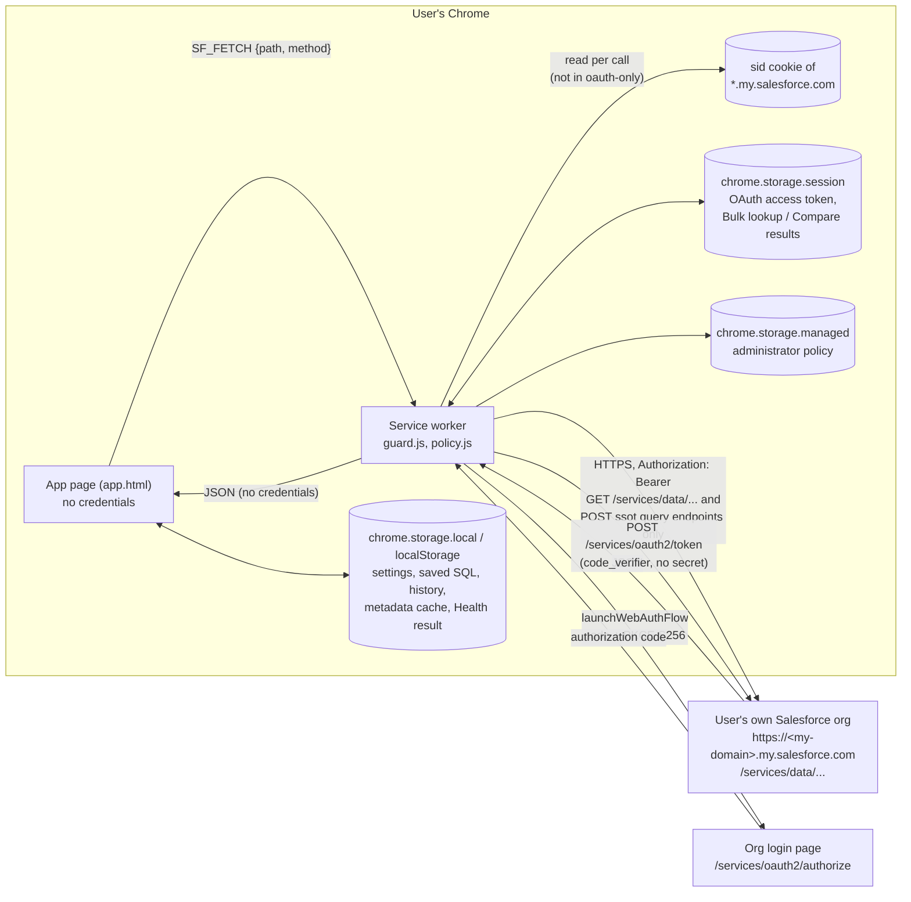
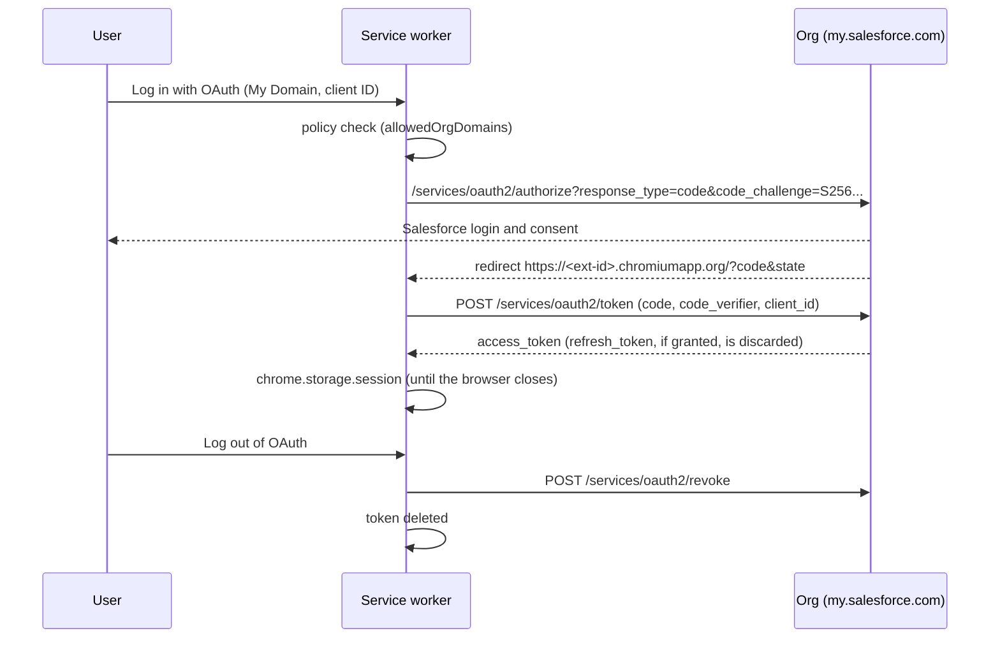

# Data Cloud Inspector: security summary

For security and privacy reviewers. Applies to version 1.0.8 and later (source: this repository, `main`). Publisher: Ateko. Contact: mathes.kanagarajan@cloudkettle.com (see `SECURITY.md`).

## Purpose

A read-only Chrome extension for Salesforce Data Cloud. A user who already has access to an org can look up unified profiles, check identity resolution and segments, run Data Cloud SQL, and view the data model and its health. It never changes data or setup in the org, and it has no server of its own.

## Architecture

- **Service worker** (`src/background/`): the only place that holds a Salesforce credential. It reads the session cookie or the OAuth token, makes every call to Salesforce, and applies the read-only guard and the administrator policy.
- **App page** (`app.html`, Vue 3): the user interface, opened in its own tab. It asks the service worker for data through `chrome.runtime` messages and never sees a session ID or token.
- **No content scripts**, no `web_accessible_resources`, no `externally_connectable`: no web page can talk to the extension, and the extension injects nothing into Salesforce pages. The service worker only answers messages from the extension's own pages (`src/background/index.js`).

## Data flow



### Authentication

Two ways in, both to the user's own org only:

1. **Browser session (default).** The user is already logged in to the org in Chrome. For each call, the service worker reads the `sid` cookie of the org's My Domain (`chrome.cookies`, host permission `*.my.salesforce.com`), and sends it as `Authorization: Bearer` with `credentials: 'omit'` to that same host. The cookie is never stored, logged or passed to the app page. The org is identified by the 15-character org ID at the start of the session ID.
2. **OAuth (optional; the only way under `authMode: oauth-only`).** Authorization code flow with PKCE (S256) through `chrome.identity.launchWebAuthFlow`, against the org's own External Client App, created by the org's admin. Public client: no client secret exists anywhere. No `scope` parameter is sent, so the scopes are exactly those the admin gave the External Client App. The `state` value is checked, and the token's org ID must match the org being logged in to.



| Token | Where | How long | Leaves the browser |
|---|---|---|---|
| `sid` cookie | Chrome's cookie store (owned by Salesforce) | read per call, never copied | only to the org it belongs to |
| OAuth access token | `chrome.storage.session`, key `dci_oauth_<orgId>` | until log out (revoked), a 401, or the browser closes | only to that org |
| OAuth refresh token | never stored | | |
| OAuth client ID (not secret) | `chrome.storage.local` | until deleted in Settings | only to that org's login |

### Read-only guard

`src/background/guard.js` refuses every request except `GET`/`HEAD` on `/services/data/...` and `POST` to the three Data Cloud query endpoints (`ssot/query-sql`, `ssot/queryv2`, `ssot/query`), which read. Apex REST, Tooling writes, Composite, `PATCH`, `PUT`, `DELETE` and any other `POST` are refused before a credential is touched. Data Cloud SQL is read-only on Salesforce's side as well. The guard is a code control: the Salesforce-side control is the user's own permissions, and for OAuth the External Client App's scopes.

## Permissions

| Permission | Why | Can it be narrowed? |
|---|---|---|
| `cookies` | Read the `sid` cookie of the org's My Domain to call the org as the user. | Not used under `authMode: oauth-only` (the policy stops all cookie reads; the permission stays in the manifest because Chrome permissions are per package). |
| `storage` | Settings, saved SQL, metadata cache (`local`); OAuth token and people's data from Bulk lookup and Compare (`session`); administrator policy (`managed`). | `disableCache` and `disableQueryHistory` limit what is kept after the browser closes. |
| `identity` | `launchWebAuthFlow` and `getRedirectURL` for Log in with OAuth. No `getAuthToken`, no Google account access, no `oauth2` manifest block. | |
| `activeTab` | On a click on the toolbar icon, read the current tab's address to open on the same org. | |
| Host `https://*.my.salesforce.com/*` | The org's API host, and where its session cookie lives. Covers production, sandboxes (`*.sandbox.my.salesforce.com`) and scratch orgs. | Use `ExtensionSettings` `runtime_allowed_hosts`/`runtime_blocked_hosts` and the `allowedOrgDomains` policy to limit it to your own org (see `docs/enterprise-deployment.md`). |
| Optional host `https://*.cloudforce.com/*` | Older orgs on that domain. Requested only when the user turns it on in Settings. | Leave off; block with `runtime_blocked_hosts`. |

Not requested: `tabs`, `scripting`, `webRequest`, `declarativeNetRequest`, `<all_urls>`, `unlimitedStorage`, `*.force.com`, `*.salesforce-setup.com`, content scripts. Removed in 1.0.8: `unlimitedStorage`, `*.salesforce.com` (all subdomains), `*.force.com`, `*.salesforce-setup.com`, and `*.cloudforce.com` as a required host.

## Content Security Policy

```
default-src 'self'; script-src 'self'; object-src 'none'; base-uri 'none'; form-action 'none';
frame-ancestors 'none'; style-src 'self' 'unsafe-inline'; img-src 'self' data: blob:;
font-src 'self' data:; connect-src 'self' https://*.my.salesforce.com https://*.cloudforce.com;
frame-src 'self' blob: data:; worker-src 'self'
```

No `eval`, `new Function` or remote code in the source or the bundle; every script and font is in the package. `'unsafe-inline'` applies to styles only (the editor and charts set inline styles). `connect-src` stops any call to a host other than Salesforce, even if a dependency tried one.

## Storage

| What | Area | Contains personal data? | Kept |
|---|---|---|---|
| Settings, layouts, theme, tips, last org, data space | `localStorage` | no | until deleted |
| Saved queries, SQL tabs, Query Builder drafts | `chrome.storage.local`, `localStorage` | only values the user typed into SQL | until deleted |
| Query run history (last 50) | `chrome.storage.local` | only values the user typed into SQL | until deleted; off under `disableQueryHistory` |
| Saved orgs (domain, org ID, username, optional name) | `chrome.storage.local` | the user's own Salesforce username | until deleted |
| Metadata cache (objects, fields, streams, mappings, rulesets, segment names, usage) and Health result | `chrome.storage.local` | no (setup, not records) | object list until Refresh; other org data refreshed after 30 min and dropped after 7 days; session only under `disableCache` |
| Bulk lookup and Compare results | `chrome.storage.session` | yes (people's records) | until the browser closes |
| OAuth access token | `chrome.storage.session` | credential | until log out or the browser closes |
| Profiles, SQL results, records on every other page | memory only | yes | until the tab closes |

Settings, Storage lists everything with its size and a Delete per item and for everything.

## Network calls

| Destination | When | What is sent |
|---|---|---|
| `https://<org>.my.salesforce.com/services/data/...` | every page | the request path and, for SQL, the query; `Authorization: Bearer`; `Sforce-Call-Options: client=DataCloudInspector` |
| `https://<org>.my.salesforce.com/services/oauth2/token`, `/revoke` | Log in with OAuth, Log out | code, PKCE verifier, client ID; the token to revoke |

Nothing else. No analytics, telemetry, error reporting, CDN fonts or scripts. Two user actions open other sites in a new tab, outside the extension's network calls:

- **Open in Diagramforce** (off by default; blocked by `disableDiagramforce`): opens diagramforce.com and passes the diagram's object, field and relationship names with `postMessage`. No records or session.
- **Feedback**: opens a `mailto:` email in the user's own mail app. The extension sends nothing.

Links in Help open developer.salesforce.com, admin.salesforce.com and similar documentation pages.

## Administrator controls

Through Chrome policy (`chrome.storage.managed`, schema `public/managed_schema.json`; deployment steps in `docs/enterprise-deployment.md`):

| Policy key | Effect |
|---|---|
| `authMode: "oauth-only"` | The session cookie is never read. Users log in through your External Client App, whose scopes, IP ranges, session policies and revocation you control. |
| `allowedOrgDomains` | Only these My Domain hosts (exact, or `*.suffix`) are listed or called; everything else is refused in the service worker and at OAuth login. |
| `disableCache` | Metadata caches and Health results are kept only until the browser closes. |
| `disableQueryHistory` | No SQL run history is kept (and any existing history is cleared). |
| `disableDiagramforce` | Open in Diagramforce is unavailable. |

Settings shows the policies in force under "Set by your administrator". Chrome's own `ExtensionSettings` (`runtime_allowed_hosts`, `runtime_blocked_hosts`) adds a browser-enforced host limit on top.

## Supply chain

- Dependencies are locked in `package-lock.json` (`npm ci`). Runtime libraries are bundled at build time (Vue, CodeMirror, dagre, sql-formatter, JSZip, html-to-image, lucide icons, SheetJS `xlsx`).
- `xlsx` 0.20.3 comes from SheetJS's own CDN tarball (the npm registry copy stopped at 0.18.5 with known issues). Scanners that read the npm advisories report GHSA-4r6h-8v6p-xvw6 (fixed in 0.19.3) and GHSA-5pgg-2g8v-p4x9 (fixed in 0.20.2) against it; both are fixed in 0.20.3, so these are false positives.
- Every pull request, push to `main` and version tag runs `.github/workflows/security.yml`: tests, build, the manifest guard (`scripts/manifest-guard.mjs` against `security/manifest-baseline.json`: permissions, hosts, OAuth scopes, content scripts, CSP, every URL host in the built files, and which source files make network calls), gitleaks on the full history, npm audit, osv-scanner, semgrep and retire.js on `dist/`. Actions are pinned to commit SHAs, scanner binaries to SHA-256, and the workflow token is read-only. Dependabot watches npm and the Actions.
- A version tag runs `.github/workflows/release.yml`: builds twice to prove the zip is reproducible, runs the scans, and drafts a GitHub release with the zip, its SHA-256 and `security/scans/<version>.md`. Publishing (`.github/workflows/publish.yml`) needs a signed, GitHub-verified tag, a rebuild that matches the release zip byte for byte, and the maintainer's approval in a protected environment; it reaches the store API through Workload Identity Federation, with no stored key. After the store publishes, `verify-store` compares the CRX the store serves with the release zip (`security/store-diff/`). Full steps: `docs/release-process.md`. Audits by hand are in `security/audits/`. All of these are automated, self-run results, not an independent audit.
- Builds are reproducible: `npm ci && npm run package` writes the zip and its SHA-256 (`scripts/package.mjs`); building the same commit twice gives the same hash.
